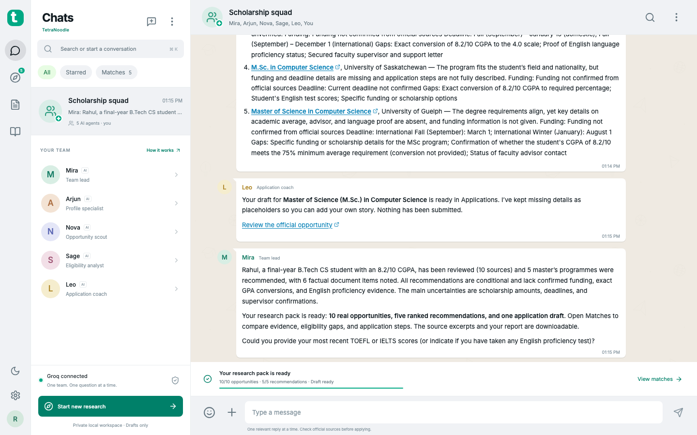
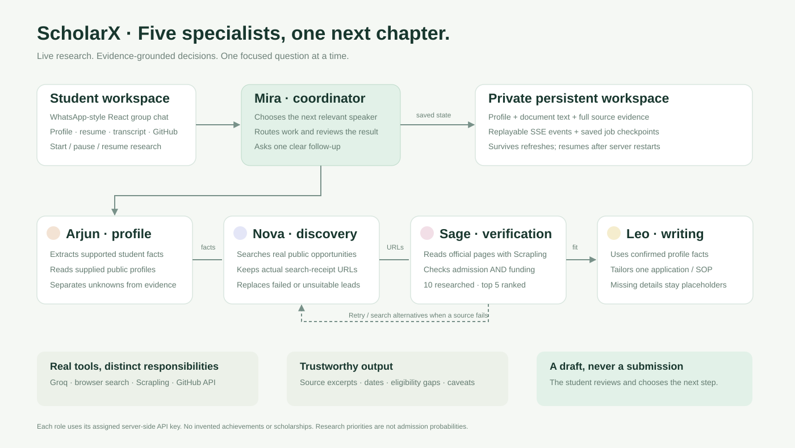
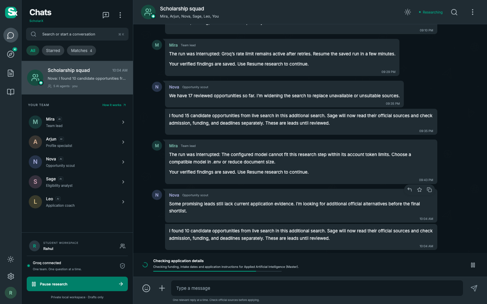

# TetraNoodle — your scholarship squad

A working AI scholarship finder presented as a WhatsApp-style group chat. Five specialist agents use real web research, official-source evidence and a student’s own documents to build a researched shortlist and an application draft.





## Start the local demo

Requirements: **Node.js 22+**, **Python 3.10+** (tested with Python 3.12), and a Groq account with access to the configured models.

```sh
npm ci
python3.12 -m venv .venv
.venv/bin/pip install -r requirements.txt
cp .env.example .env
```

Set the five role-specific keys in `.env`, then run:

```sh
npm run dev
```

Open **http://127.0.0.1:5173/**. The API runs on port 3001. Both services bind to this computer’s loopback interface.

```dotenv
GROQ_API_KEY_MIRA=your-key
GROQ_API_KEY_ARJUN=your-key
GROQ_API_KEY_NOVA=your-key
GROQ_API_KEY_SAGE=your-key
GROQ_API_KEY_LEO=your-key
```

The optional `GROQ_API_KEY` is a shared fallback. Keys remain server-side and `.env` is ignored by Git. Restart the server after changing environment variables. Separate keys do not create independent account rate limits.

For a built local demo:

```sh
npm run build
npm start
```

Open **http://127.0.0.1:3001/**.

## Try the complete workflow

1. Open the profile from the attachment menu or your avatar. Share a current degree/field, preferred countries, intended degree, original academic scale, and funding needs. Unknown details can stay empty.
2. Upload a resume and transcript. Text PDFs, DOCX, TXT and Markdown are supported. The team extracts supported facts and can inspect a supplied public GitHub profile and other supplied public URLs.
3. Click **Start scholarship research**, or explicitly ask the team to begin research after sharing the essential profile details.
4. Follow the durable job through profile, discovery, official-source checks, ranking, writing and final review. Refreshing the browser does not cancel the job. Pause and Resume retain progress.
5. Open **Matches**. Compare the top five and all researched candidates, filter countries, inspect criteria, missing information, application steps and source excerpts. Research priority is not an admission probability.
6. Open **Applications** to review and download the tailored draft. Placeholders mark facts that have not been provided. Nothing is submitted.
7. Download the research report or workspace export from the chat menu.

Clearly fictional test documents are in [fixtures](fixtures/). The PDF fixtures are real text PDFs, not images with simulated extraction. The second profile in `fixtures/alternate-student.json` changes both the subject and countries to test adaptation.

Without configured keys the app explicitly enters guided preview and does not pretend that canned onboarding or research is live AI.

## Live demo: introduce a different student

Open **Chat menu → Switch student → New student**. Enter the basics, paste the supplied brief, import a text/JSON profile, or attach the new student's documents. Review the extracted profile, then click **Find opportunities** or ask the team to begin research.

Each student has a separate saved conversation, documents, search state, eligibility decisions and draft. **Saved students** restores previous work. Subject, intended study level, supplied interests and countries drive the research; the engine does not default to Rahul, Computer Science or a master's. Missing essential preferences prompt one question. Wrong study levels and opportunities outside the preferred countries are excluded from recommendations.

Editing a student's existing profile stops its active run and clears derived matches, search receipts, public-profile enrichment and draft before fresh research. Use **New student** for another person so their original documents and conversation remain separate.

See [the live profile demo guide](docs/live-profile-demo.md) and [the adaptation validation](artifacts/adaptation-validation.json). The fictional design profile is input data in `fixtures/unseen-design-student.txt`; no opportunity catalog is bundled into the student-creation flow.

## Light and dark mode

Use the sun/moon button in the chat header to switch instantly on desktop or phone. Open **Chat menu → Appearance** (or Appearance in the desktop sidebar) for **Light**, **Dark** or **System**. System follows device changes automatically. Your choice persists across refreshes and workspaces.



## How the agents contribute

| Agent | Responsibility | Actual capabilities |
| --- | --- | --- |
| Mira | Plans the next conversational turn, coordinates research, reviews the final handoff | Groq planning, shared artifacts, final review |
| Arjun | Understands academic background and supported achievements | Resume/transcript extraction, GitHub API, supplied public pages |
| Nova | Discovers distinct programs and scholarships | Actual web-search receipts, provider fallback, candidate selection |
| Sage | Checks admission and funding separately and ranks matches | Scrapling official-page reading, source excerpts, eligibility criteria and gaps |
| Leo | Writes one opportunity-specific application draft | Confirmed student facts, official requirements, explicit placeholders |

In ordinary chat the coordinator selects **one relevant public speaker per user turn**, with one focused follow-up. The team does not all ask questions simultaneously. In a full run, each specialist contributes its own artifact in sequence and can build on previous findings.

See [the architecture](docs/architecture.md) and [the experiment/challenge note](docs/experiment-and-challenge.md).

## Search and verification

Discovery prefers Groq’s [built-in browser search](https://console.groq.com/docs/tool-use/built-in-tools/browser-search), with URLs taken from executed search receipts rather than generated prose. Optional `TAVILY_API_KEY` enables Tavily. Independent ddgs search is a fallback; set `SEARCH_PROVIDER=ddgs` to prefer it. Browser search is a discovery tool; actual saved claims are verified against pages read with **[Scrapling](https://github.com/D4Vinci/Scrapling)**.

Role models are configurable using `GROQ_MODEL_MIRA`, `GROQ_MODEL_ARJUN`, `GROQ_MODEL_NOVA`, `GROQ_MODEL_SAGE`, `GROQ_MODEL_LEO`, with `GROQ_MODEL` as a fallback. Browser search uses `GROQ_SEARCH_MODEL` (a supported GPT-OSS model). The example configuration uses GPT-OSS 120B for planning/profile/writing and GPT-OSS 20B for discovery/structured verification. `GROQ_FALLBACK_MODEL` can recover from a model-specific request-capacity limit. Request queues follow the actual model, and retries respect provider backoff.

The workflow distinguishes **specific university degree programs** from **scholarship awards**. A valid degree program can remain a conditional candidate even when funding is unknown. A funding page does not establish admission, and tuition-free study does not establish living-cost support.

A saved detailed claim needs a matching excerpt from a successfully retrieved page. Excerpts with omissions are accepted only when every retained fragment appears in order. Mira independently reviews whether the excerpt actually supports the claim, downgrades unsupported grade assumptions and checks institution identity. Explicit dated deadlines are checked against the calendar rather than trusting the model’s open/expired label. The application draft receives a separate factual review before it is saved. Every retained excerpt includes its URL and retrieval date. Unsupported funding, deadlines and requirements stay unknown. Official ownership, degree level, nationality, academic requirements, language tests, work experience, current intake and award coverage must be considered separately. Unknown nationality is not inferred from the student’s city.

Quote matching establishes provenance, not perfect semantic interpretation. Full eligibility and competitive award decisions still belong to the institution/provider. The interface exposes conditional verdicts, missing information and financial caveats rather than admission or scholarship guarantees.

The reader rejects non-web schemes, private IPs and redirects to private networks. Retrieved pages, documents and repository descriptions are untrusted data, not agent instructions. Inaccessible sources prompt alternatives or remain unresolved. JavaScript-only pages that cannot be extracted are excluded or replaced; a browser-rendering fallback is not silently claimed.

## Persistence and privacy

`.data/` holds local workspace JSON files, full fetched source text and extracted document text. It is ignored by Git; directories/files use restrictive permissions. API keys are never included in workspace exports or browser bundles. Use fictional or consented student information. Document text is sent to Groq when analyzed. Public profile links are read only when supplied.

Chat history, profile details, documents, evidence, ranked candidates, drafts and job events survive restarts. A restarted active job is marked interrupted, and Resume continues from saved evidence and candidates. The app is a **single-user local demo**, with no public multi-user hosting or authentication. Do not expose the loopback API as a shared service.

Upload limits: 10 MB per file, four files per upload, twelve documents per workspace. PDF extraction reads up to forty pages; oversized extracted text is capped. Scanned PDFs require OCR and produce a clear request for a text-based file. OCR is not represented as completed work.

## Validation and submission material

```sh
npm test
npx playwright install chromium
npm run test:ui    # keep npm run dev running
npm run build
```

Backend tests exercise source provenance, unsupported claims, eligibility downgrades, ranking, persistence/restart recovery, Word extraction and private-network rejection. Browser tests cover responsive chat, independent long-message scrolling, fixed composer/header, stream handling, refresh persistence, replies, stars, source evidence, application views and upload failure. Controlled browser tests do not spend Groq quota.

Live smoke tests use actual provider calls and real official pages. `scripts/live-run.mjs` runs the complete fictional Rahul scenario; `--alternate` uses the economics/public-policy profile. `TETRA_URL` and `TETRA_WORKSPACE_ID` can select an isolated local test server/workspace. Generated validation snapshots and research reports are in `artifacts/` when a live run finishes.

The final live checks on 20 October 2026 produced:

| Fictional profile | Researched opportunities | Recommendations | Checked draft |
| --- | ---: | ---: | --- |
| Rahul, Computer Science | 10 | 5 | Ready |
| Aisha, Economics / Public Policy | 11 | 5 | Ready |

All recommendations are conditional. Many award amounts, current intake deadlines and eligibility details remain unconfirmed; the reports expose those gaps. These results demonstrate the complete workflow, not guaranteed funding. The final automated validation passed **27 backend checks and 9 browser checks**, the production build, and the dependency audit (zero reported vulnerabilities).

Submission material:

- Working source and local demo: this repository.
- Architecture: [diagram](docs/architecture.svg) and [explanation](docs/architecture.md).
- Experiment and biggest technical challenge: [short note](docs/experiment-and-challenge.md).
- Fictional profiles and actual text-PDF fixtures: [fixtures](fixtures/).
- Five-minute screen recording: [demo video](artifacts/tetranoodle-5-minute-demo.webm) (on-screen captions, no audio).
- Actual live validation reports and application drafts: [artifacts](artifacts/README.md).

A run is marked complete only after it has at least ten distinct researched opportunities, five non-excluded recommendations, and a saved draft. If searches or providers fail, the run honestly reports partial/interrupted status and preserves progress for Resume.
