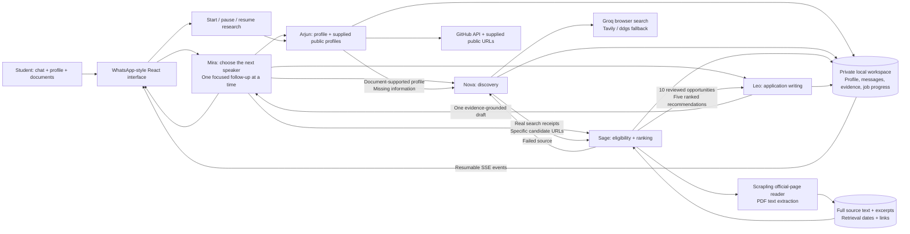

# How the agents collaborate

TetraNoodle has two connected paths. Ordinary chat is coordinated one turn at a time. The full research job passes explicit artifacts through all five specialists, independently of the browser connection.

Each specialist uses its own server-side Groq API key. Mira’s planning step selects one public speaker for normal chat. That speaker answers the student and asks, at most, one focused question. Other specialists retain their distinct jobs; they do not each ask another question on the same turn.

The research job has explicit completion criteria: ten distinct researched opportunities, five recommendations that are not known to be ineligible or expired, and a saved application draft. It reports partial or interrupted status if these criteria are not met.

Search results are discovery leads, not evidence. Scrapling fetches actual official pages. A saved claim about funding, deadline, admission requirements or application steps must cite a verbatim excerpt from a retrieved page. Unknowns remain unknown. An excerpt match establishes provenance. Mira independently checks whether each claim is entailed by its excerpt and whether grades or missing student details have been overinterpreted. Calendar checks override incorrect past/upcoming labels. A second draft review and conservative text guards replace unsupported coursework, degree completion and self-certified eligibility with placeholders. User review remains necessary.

Job progress and extracted document text persist in the ignored `.data/` folder, with restrictive file permissions. The browser subscribes to replayable events and can reconnect after a refresh. A server restart marks active jobs interrupted, and Resume continues from saved candidates and evidence.

Groq failures retry with provider backoff. Search can change providers. An unavailable official source prompts another search. Failed or unrelated candidates are excluded, and Nova can widen discovery to replace them. No agent has a tool to submit an application.
