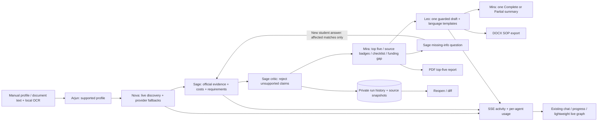
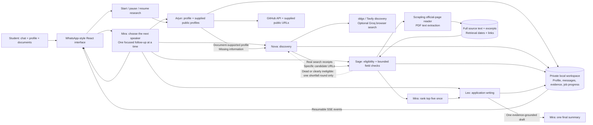

# How the agents collaborate

The research coordinator persists a forward-only phase cursor. Sage performs the independent critic check inside eligibility; Mira ranks only after Sage finishes. Existing tools, artifacts, fallback providers and SSE transport are reused:

See [the enhancement audit](enhancements-audit.md) for scope, validation, source limitations and short demonstration steps.

ScholarX has two connected paths. Ordinary chat is coordinated one turn at a time. The full research job passes explicit artifacts through all five specialists, independently of the browser connection.

Each specialist uses a server-side role key; roles may share a key when fewer than five keys are supplied. Mira’s planning step selects one public speaker for normal chat. That speaker answers the student and asks, at most, one focused question. Other specialists retain their distinct jobs; they do not each ask another question on the same turn.

The research job has explicit completion criteria: ten distinct suitable reviewed opportunities, five recommendations that are not known to be ineligible or expired, an AI-reviewed application draft, and evidence for funding, current intake/deadline, entry requirements and application instructions across all five. Otherwise Mira posts one Partial summary with verified and partial counts and closes the run. Partial recommendations can retain confirmed official identity while clearly labeling unaudited fields Unverified. Source snippets alone cannot establish verified claims.

Search results are discovery leads, not evidence. Scrapling fetches actual official pages, with the existing full-page extraction fallback. A saved funding, deadline, admission or application claim must cite a verbatim excerpt. Sage's independent critic pass checks meaning, applicability, grades and missing student facts. Calendar checks override incorrect past/upcoming labels. Leo reviews his own draft against the supplied facts; conservative text guards replace unsupported coursework, degree completion and self-certified eligibility with placeholders. User review remains necessary.

Job progress and extracted document text persist in the ignored `.data/` folder, with restrictive file permissions. The browser subscribes to replayable events and can reconnect after a refresh. A server restart marks active jobs interrupted, and Resume continues from saved candidates and evidence.

Groq failures retain their existing retry/backoff and fallback behavior. Sage may search for the same opportunity's official source or missing fields. Nova stops at ten candidate URLs. Only dead or clearly ineligible candidates permit one extra discovery round for the shortfall, before Sage finishes. Missing funding or dates do not restart discovery. No agent has a tool to submit an application.

## Adapting to a new student

The student switcher creates a new UUID workspace through the shared creation endpoint. Plain text is parsed by Arjun with matching quotes; labelled fields and canonical JSON preserve explicitly supplied facts. No original student's documents, conversation, GitHub enrichment, search receipts, eligibility decisions or draft are copied. Saved workspaces can be restored independently.

A research brief records the intended degree level, subject, explicitly supplied related interests, destinations, original grades, nationality, intake, language scores and funding needs. Discovery is constrained to this brief. Wrong study levels and opportunities outside the stated countries are excluded from recommendations. Missing essentials prompt one question rather than defaulting to a master's. A profile revision cancels the active run before its derived state is cleared, and a client workspace generation prevents delayed old replies from changing a different student's interface.

The live adaptation validation uses a communication-design student seeking interaction design in Finland, Sweden and the Netherlands. Its actual results and validation metadata are in `artifacts/adaptation-validation.json`. See `docs/live-profile-demo.md` for the demonstration steps.

Document additions and removals invalidate derived research and clear unchanged document-derived profile fields. Conflicting saved and document-supported student facts stop research for clarification. The client replaces canonical profile snapshots and ignores late results from a previous student.

## Bounded delivery and targeted verification

A run allows eight minutes total active time (`RESEARCH_BUDGET_MS`) and 100 logical tool/model calls (`RESEARCH_MAX_TOOL_CALLS`) by default. Draft time is reserved inside that total; `DRAFT_BUDGET_MS` caps it at 45 seconds by default. Sage has 45 seconds total per candidate and at most two persisted targeted retries per field. Pausing does not reset elapsed time, receipts or retry counters. Budget exhaustion advances to saved ranking, one draft attempt or labeled scaffold, and one Partial summary. A scaffold never satisfies full completion.

Manual Resume continues a paused or interrupted cursor; chat messages cannot silently resume it. A finished run stays closed and its controls open saved matches. To research again, the user must explicitly start a fresh run. The targeted missing-student-info resolver remains a separate user action for affected matches. Once-only `agent_lifecycle` and `pipeline` events retain the same replayable event transport as chat and progress.

Starting research while chat is active is rejected. Pausing before the queued job begins propagates the cancellation before any profile or internet call. Counts distinguish independently checked opportunities from pending leads.

## Required-profile conversation

Start research checks uploaded documents and required preferences before discovery. A persisted intake state lets Arjun collect current education, intended degree/subject and destinations through one focused question per turn. Incoming answers are extracted by Arjun and accepted only when their values and supporting quotes occur in the student’s latest message. Existing details are not re-asked, unknown answers are not fabricated, and optional eligibility facts remain unconfirmed.

When the last required answer is saved, the chat route clears its busy flag before launching the background research job. This avoids starting a job while a specialist reply is still active. The same handoff works when the remaining details are entered through the profile form. Intake can be paused, survives refreshes and remains isolated to the current student.
