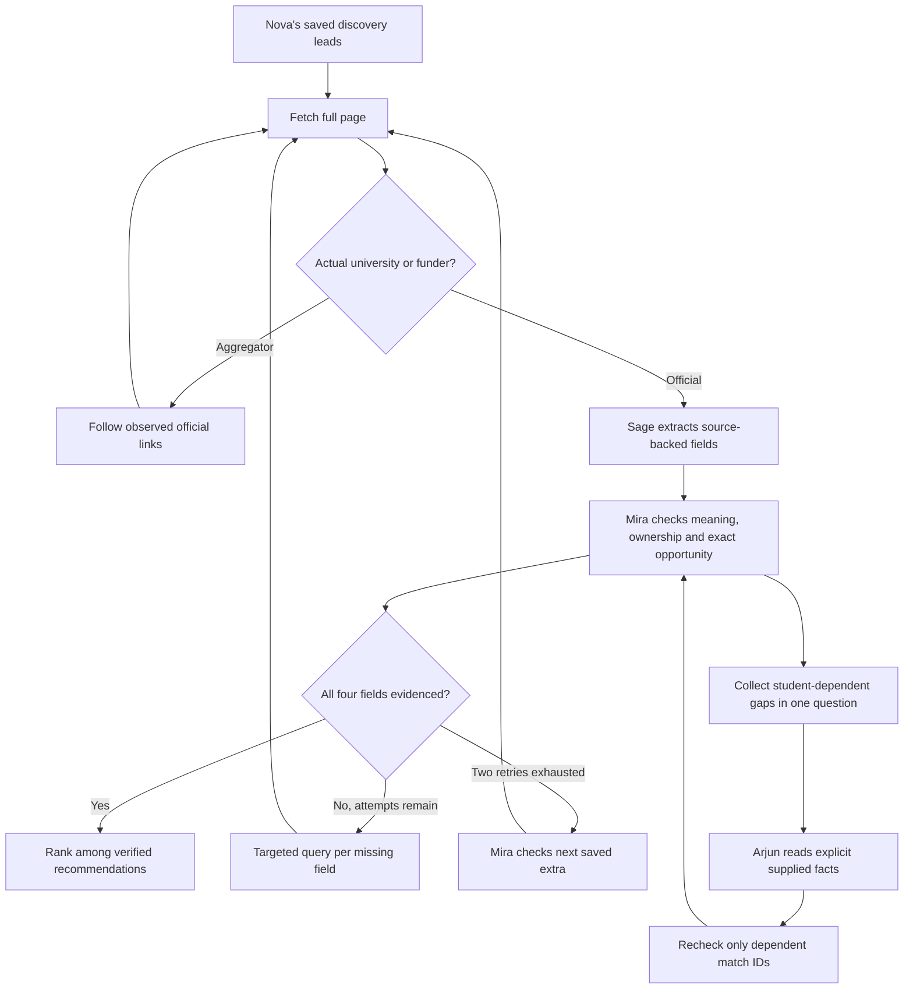

# Sage verification audit and repair

This change extends the existing research flow, agent roles, saved sessions and SSE events. Existing student workspaces and `.env` were not edited. The landing page and its removed animation pause button are preserved.

## Audit: why recommendations stayed unconfirmed

| Finding before this change | Evidence in the existing implementation | Repair |
| --- | --- | --- |
| An accessible aggregator could be rejected before its official outbound link was followed. Only a failed read triggered an official-source search. | `server/research.js`: `reviewCandidate`, `validateReview`; supporting links were restricted to the initial host. | `server/official-source.js`: `resolveOfficialSource` fetches observed outbound provider links and checks ownership before fact extraction. Aggregator text is never supplied as claim evidence. Mira independently checks ownership again. |
| Targeted searches already existed, but only one detail pass ran for each of the first five candidates. Requirements and application instructions shared one search topic. | `server/research-details.js`: `detailSearchPlan`, `deepenReview`; `server/research.js`: old `deepenPack` marked each URL checked once. | Separate funding/deadline/requirements/application searches, a second query variant, at most two persisted attempts per missing field, followed by Mira's review after each attempt. |
| Full pages were fetched, but bounded excerpts could miss late sections. Scrapling failure had no full-page extraction fallback. | `server/tools.js`: `read_page`, `relevantText`; `server/scraper.py`: `read_page`; initial extraction used early relevant text. | Topic windows from fetched page bodies; raw text retained for exact quote checks; Scrapling then optional Tavily Extract. Search snippets remain discovery-only. Independent supporting fetches run in bounded groups of three. |
| Repeated retries could choose the same two pages, including an old call PDF. | `server/research-details.js`: `selectSupportingPages`. | Remember attempted supporting URLs, prefer new pages on retry two, and exclude explicitly old-year supporting URLs. Absence of a year never establishes a current intake. |
| Five recommendations and ten suitable candidates stopped replacement research even if fields were missing. Saved, unreviewed discovery extras were not consumed for detail completeness. | `server/research-delivery.js`: `needsMoreCandidates`; `server/research.js`: replacement condition. | `server/verify-shortlist.js`: after two failed attempts, Mira prioritizes the next saved extra. Fully evidenced suitable candidates rank first. Exhausted candidates remain in All researched. At most ten saved extras are checked in a pass; no fabricated or new hardcoded opportunities. |
| A global integrity flag could give an incomplete/yearless field a Verified badge. Repeated status bubbles and fractions such as 12/10 were confusing. | `src/Matches.jsx`, `src/MatchDetails.jsx`, `src/App.jsx`; `server/store.js`: `record`, `snapshot`. | Always-visible per-field labels and source links, explicit primary source URL, `N found (10 required)`, exact status deduplication on persistence, snapshot and SSE ingress. Student messages are never deduplicated by content. |
| The missing-info resolver asked only about the first field. Substring matching confused “preference” with “reference” and “undergraduate” with graduation. | `server/missing-info.js`: old `missingRequests`, `askMissing`. | One sourced question collects all relevant student gaps. Whole-word dependencies, partial answers, saved retry state, and only affected IDs passed to review/audit. Source facts on those matches are retained; unaffected matches stay saved. |
| A model could mark an unsupplied language result as not met or reject a final-year student without a completion-at-application rule. | `server/research.js`: `validateReview`, `auditPack`. | Deterministic unknown handling. Pending degree completion stays unknown unless the cited source explicitly requires completion when applying. No grade equivalence is inferred. |
| A quote could belong to another award on the same page; a copyright year could be mistaken for the intake year. | Found during manual inspection of the live benchmark's intermediate claim excerpts. | `server/field-evidence.js`: conservative field guards; `integrityContext` now includes source titles and preceding source context. Mira checks the exact award/program/concentration and date-table columns. Legacy audits are rechecked under the new context version. Narrow individually audited criteria can replace rejected compound summaries. |

## Resulting flow



## Evidence semantics and limits

- **Verified**: a narrow supported field passed source and independent meaning checks. It does not establish admission, grade equivalence, award receipt or ability to pay.
- **Unverified**: source evidence exists, but the field is not independently established or the current intake remains unresolved.
- **Missing**: no acceptable evidence for that field. Missing student facts are tracked separately from missing official-source facts.
- Two field attempts persist across Resume and Verify missing details for the same profile. Repeated clicks cannot silently reset the retry limit. A new research run or changed profile starts a new verification context.
- A page's domain does not establish programme applicability. Another concentration's deadline, another award's procedures, and footer years cannot be borrowed.
- Full fetched text is bounded at 120,000 characters for storage/resource control. Model inputs use exact excerpts from that fetched body. No search snippet can satisfy a claim.
- Tavily Extract is optional and uses the existing `TAVILY_API_KEY`. The implementation follows the [official Extract API](https://docs.tavily.com/documentation/api-reference/endpoint/extract): `raw_content`, no snippet query/chunk options, and per-URL failure handling. Without that key, live reads continue through Scrapling.
- The existing overall research timeout still saves partial results. The system cannot guarantee five fully evidenced matches when current official calls are unpublished, inaccessible or absent from the saved candidate pool.

## Validation and live counts

Live results, timing, exact field gaps, source URLs and retry activity are recorded in the accompanying verification validation artifact. The baseline and updated runs use the same fictional Rahul profile and saved discovery seed in isolated temporary storage. These are resumed-verification benchmarks, not fresh discovery runs. Existing student sessions are read-only.

The first intermediate result reported two complete matches; manual inspection exposed incorrect cross-award and footer-year evidence. It is retained as an intermediate diagnostic, not accepted as the final trustworthy count. The final strict run is reported separately.

Reproduce with a fictional/consented saved workspace containing its evidence and review receipts:

```sh
node scripts/check-verification.mjs --seed=/absolute/path/to/saved-fictional-workspace.json --label=after --profile=fixtures/rahul-profile.json --budget=480000
```

The script runs real configured providers, copies the input into temporary storage, writes a source-linked report, and deletes temporary student state. It never edits the seed. Automated regression tests use explicit synthetic fixtures and do not establish live scholarship availability.

## Files for this change

Backend: `server/research.js`, `server/research-details.js`, `server/research-quality.js`, `server/missing-info.js`, `server/tools.js`, `server/scraper.py`, `server/store.js`; new `server/official-source.js`, `server/page-extract.js`, `server/verify-shortlist.js`, `server/field-evidence.js`.

Shared/UI: `shared/models.d.ts`, new `shared/status-messages.js`, `src/App.jsx`, `src/Matches.jsx`, `src/MatchDetails.jsx`, `src/enhancements.css`.

Validation: `tests/research-details.test.js`, new `tests/verification-flow.test.js`, `tests/browser/enhancements.spec.js`, new `scripts/check-verification.mjs`, this audit, and `artifacts/rahul-verification-*.json`.

## Accepted result

| Measure | Before | After strict checks |
| --- | --- | --- |
| Fully evidenced recommendations | 1/5 | 2/5 |
| Independently reviewed opportunities | 5 | 6 |
| Funding fields evidenced | 2/5 | 4/5 |
| Current intake/deadline fields evidenced | 2/5 | 2/5 |
| Entry requirement fields evidenced | 3/5 | 5/5 |
| Application instruction fields evidenced | 5/5 | 4/5 |
| Elapsed time | 4m 16s | 10m 38s |
| Test work-budget cap | 8 minutes | 12 minutes |

The older application count included unsupported procedures, so its decline is intentional. This is a quality benchmark, not a speed comparison. The application default remains eight minutes; longer checks save work for Resume, without replenishing the same field’s retry allowance. The final result is still partial: 6 suitable reviewed opportunities, not the complete 10 required by the hackathon.

Remaining gaps:

- **Master of Science (M.Sc.) in Computer Science (Thesis)**: current intake / deadline.
- **Master of Artificial Intelligence Design & Development**: current intake / deadline; application instructions.
- **Computer Science: Applied Computing MScAC; Concentration: Artificial Intelligence**: funding; current intake / deadline.

Nova reached its primary model’s daily allowance and recovered using the existing fallback model. No secret values appear in the report.

`artifacts/verification-validation.json` contains the accepted comparison and checks. Production UI validation reopened the real saved pack on an isolated API server: five recommendations, twenty visible per-field label elements, source URLs, chat, documents, applications, Home/Launch navigation, no page errors, and one combined question for language results, references and graduation.

Final deterministic guards also reject a different concentration's explicit degree heading and an unqualified programme fee supported only by a “most graduate programs” statement. The accepted report and production UI were revalidated after these guards: 2/5 complete; the Guelph application summary narrows to its individually audited account-creation step. Final checks: 103 backend tests, 42 browser tests, type contracts and production build pass.
