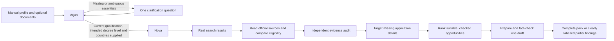

# Scholarship workflow and provider allowances

ScholarX keeps the group-chat presentation and concentrates the interface on student profiles, uploaded documents, research activity, sourced matches and application drafts. Starred-message navigation, star actions and the emoji picker have been removed. Reply references, copying, search, appearance settings and student management remain useful to the research workflow.

The five agents retain separate server-side keys. Requests serialize by account key and model, so one account's retry does not block another account. Public conversational turns remain sequential.

A nonempty subject is insufficient to authorize research: `cse` needs a degree-level clarification, and `final year` needs a current qualification. The profile screen and backend share these checks. Saved findings cannot bypass this gate through a detail-only or finish action.

Groq's minute and daily allowances are separate. Token-limit headers provide the account/model's current token budget. Before another request, the backend estimates its input plus maximum output and waits for the needed token shortfall to replenish. This is labelled scheduling, rather than quota exhaustion. Estimates are approximate; genuine 429 responses still use bounded, cancellable retries and notify the relevant agent. Provider-enforced limits cannot be removed by changing the application.

Official sources are cached for up to a day. Independent supporting-page reads can run together, while agent handoffs stay ordered. The reader prefers the page's main content to navigation. Initial verification uses bounded output and separately evidenced application steps. Detail retries prioritize the missing topic, can read an alternative supporting source, and retain previously sourced claims for another independent check. Individually approved application steps can survive rejection of an unsupported compound summary.

Discovery generates nine distinct query variants even for a single destination, with unused variants reserved for replacement passes. Exhausted cached queries are distinguished from a provider outage. When no new leads remain, checked findings continue through detail verification and drafting. If the independent search service fails, Groq's browser search can return actual tool receipts; generated prose URLs are never accepted as search evidence. Repeated Start requests while Arjun is waiting do not duplicate the pending question.

Award-title variants on a directory and its detail page are deduplicated within the same institution and overlapping study levels. Unknown residency remains unknown when a citizenship rule offers a permanent-resident or protected-person alternative; foreign nationality alone does not establish that this route fails.

Completion remains an evidence gate: ten potentially suitable checked opportunities, five recommendations with funding, current deadline information, requirements and application instructions, and an AI-reviewed draft. A partial result does not receive completed journey checkmarks. Unknown facts and unavailable official information remain visible.

Validation includes unit tests for profile ambiguity, conflicting degree levels, excerpt selection, retained evidence, alternative sources, account queue isolation, cancellation and provider scheduling; browser checks cover the simplified chat, partial status, mobile scrolling and the profile-to-research flow. Live research outcomes are recorded separately from passing automated tests.
